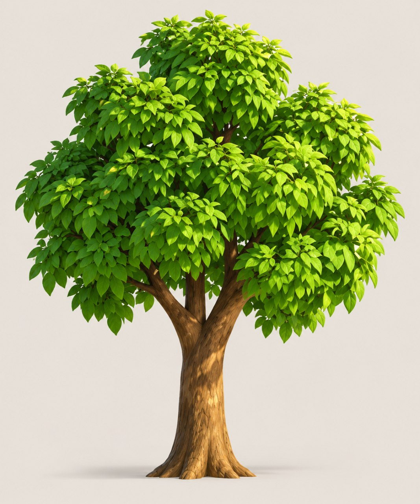

# CanopyTree — Procedural Tree Studio

A browser-based, deterministic **stylized tree generator** built with three.js and Vite.
Every tree is produced from a seed plus a small set of shape parameters: buttressed
trunk, forked limbs, rounded leaf clusters, star-shaped leaf rosettes, and a warm
studio backdrop. Look, tune, share, and export it as PNG or GLB.



*Reference look that guided the default "Reference Oak" preset.*

## Features

- **Seeded & deterministic** — the same seed + parameters always produce the same tree.
- **Live controls** — trunk, limbs, crown, leaves, and scene sliders rebuild the tree
  in place (typically 60–160 ms).
- **Six presets** — Reference Oak, Lush Broadleaf, Young Sapling, Windblown, Bonsai,
  and Autumn, each with its own seed and palette. Preset cards show live-rendered
  thumbnails.
- **Instanced foliage** — thousands of individually curved, textured leaf cards arranged
  in rosettes, with per-leaf color variation, a wind shader, and quality-based LOD.
- **Studio scene** — warm-gray gradient backdrop, three-point lighting, soft baked
  contact shadows, orbit/pan/zoom controls, optional turntable, and auto-framing.
- **Exports** — PNG at fixed standard sizes (Square 1K/2K/4K, 16:9 1080p/1440p/4K,
  or Match view), with an optional transparent background, plus binary glTF (`.glb`)
  with baked leaf instances.
- **Share links** — the full parameter state is encoded in the URL hash, so a copied
  link reproduces the exact tree. The address bar is never updated while you tune,
  and an opened share link is cleaned back to the site URL after it loads.
- **View settings** — hide the foliage or the wood to inspect structure, or switch the
  stage to flat gray or wireframe shading. These are preview-only and never affect
  exports, presets, or share links.
- **Responsive UI** — desktop side panel and a mobile bottom-sheet drawer, collapsible
  controls, keyboard shortcuts, and a help guide.

## Quick start

```bash
npm install
npm run dev      # http://127.0.0.1:5173
```

Production build:

```bash
npm run build    # output in dist/
npm run preview  # serve the production build
```

Requires Node 20+ and a WebGL2-capable browser. `vite.config.js` pins the dev server
to `127.0.0.1:5173`.

## Using the studio

- **Seed** — edit the seed text to jump to a specific tree, use the refresh button to
  regenerate the same seed, or press the dice for a new seed.
- **Sliders** — the panel shows the most-used controls first; expand **Advanced
  controls** for tabs covering trunk, limbs, crown, leaves, and scene. **Leaf
  alignment** under Leaves controls how tightly the foliage follows one canopy
  shell versus each clump fanning out on its own, and **Leaf gravity** sags the
  blades toward the ground.
- **Presets** — pick a look from the bottom rail (or keys `1`–`6`). Parameters can then
  be tuned freely.
- **Save / import** — **Save** stores the current seed, shape, foliage, and scene as a
  named look in this browser. Saved looks sit after the built-ins, can be deleted from
  their card, and can be downloaded as JSON. **Import** reads a single preset, a list,
  or a downloaded library from a JSON file, so looks move between devices.
- **View** — the View block at the top of the controls toggles **Hide leaves** and
  **Hide branches**, and switches between **Natural**, **Gray** (untextured clay), and
  **Wireframe** shading. Hiding leaves also hides the dark canopy core, so the branch
  structure reads clearly. Modes are preview-only: they do not change parameters,
  presets, URLs, or exported files, and the choice is remembered separately in the
  browser.
- **Voxelize** — the **Voxel** tab turns the trunk and selected branch levels into one
  solid volume and remeshes it, so every branch join is seamless. **Voxelize depth**
  chooses how many branch levels join the pass; deeper twigs stay as smooth tubes.
  **Voxel resolution** controls the volume detail (up to 256), while **Mesh resolution**
  sets the output remesh density independently: 1.0 keeps the full marching-cubes
  surface and values down to 0.05 produce a very light decimated asset. **Show voxel
  grid** previews the raw blocky shell; it is a diagnostic view and never reaches
  exports. The preview shows the voxelized core; deeper branch levels are preserved as
  smooth tubes and stay out of that view.
- **Collapse** — the arrow in the bottom Looks rail folds it down to its header while
  keeping Save and Import available. The close button in the top-right of the controls
  panel collapses it on desktop to a floating **Tune** button; on mobile the same
  button closes the bottom sheet. Both states are remembered in the browser.
- **Theme** — the sun/moon button flips the interface and the canvas between light and
  dark. Each backdrop has a light and a dark palette, so the stage follows the
  surrounding chrome; the choice is remembered in the browser.
- **Share** — copies a URL containing the seed and every non-default parameter. The
  address bar itself stays on the clean site URL; the encoded state is only written
  into the link that gets copied.
- **Export** — PNG renders at a fixed standard size: Square 1024/2048/4096,
  16:9 1920×1080 / 2560×1440 / 3840×2160, or Match view (fixed width, current viewport
  aspect). Square 2048×2048 is the default. GLB exports the tree geometry and
  materials only (no backdrop or shadow planes).

### Keyboard shortcuts

| Key | Action |
| --- | --- |
| `R` | Regenerate with the same seed |
| `S` | New random seed |
| `F` | Frame the tree |
| `H` | Hide / show the interface |
| `T` | Toggle turntable |
| `1`–`6` | Switch presets |
| `E` | Open export |
| `L` | Show / hide leaves |
| `B` | Show / hide branches |
| `G` | Toggle gray shading |
| `W` | Toggle wireframe |
| `?` | Open the guide |
| `Alt` + `←` / `→` | Walk the seed history |
| `Esc` | Close modals / mobile panel |

## How a tree is generated

The pipeline lives in `src/tree/` and is intentionally separated into stages:

1. **Seed & streams** (`src/rng.js`, `src/noise.js`)
   A string seed is hashed into a 32-bit state for a mulberry32 generator. Each
   subsystem gets an independent stream with `rng.fork(label)`, so changing the bark
   seed never reshuffles foliage. Value noise and FBM provide organic variation.

2. **Skeleton** (`src/tree/skeleton.js`)
   The trunk is a Catmull-Rom curve with a flared, lobed base and a forked top.
   Recursive limbs are grown from the fork with spread, upward bias, droop, and gnarl
   controls. Fork orientation, limb spacing, length, radius, and child count are all
   drawn from the seed, with one limb growing as a mild leader, so every seed gives a
   different structure on every azimuth rather than a staged front view. The crown is
   a seeded golden-angle spiral of up to 12 ellipsoid clusters (`createCrownLayout`);
   the `puffs` parameter selects how many. Each cluster gets satellite lobes that
   break the silhouette into rounded clouds, and the spiral packs them evenly around
   the trunk so the canopy stays full from front, side, and back. The skeleton also
   exports branch tips (used for bright outer rosettes) and fork-window data.

3. **Bark** (`src/tree/bark.js`)
   A hand-built 40×96 trunk mesh keeps buttress lobes locked to world-space angles.
   The trunk closes into a small dome and every branch tube starts well inside its
   parent, so no end cap is ever visible. Each tube also swells where it breaks
   through its parent. At the primary fork, a marching-cubes patch polygonises a
   smooth union of the trunk and limb centre lines and is inset slightly: it
   hides inside the tubes everywhere except the concave crotch, where the union
   bulges above the bark. There it meets the original surfaces from underneath,
   so the branch roots flow into the trunk as one continuous piece of wood
   without a collar or an exposed seam.
   Bark geometry adds carved ridges around the trunk and branches. The base is a
   second marching-cubes skin: a smooth implicit union of the lower trunk and
   several root-toe chains. It follows the same carved ridges and sits a few
   millimetres inside them, so each buttress grows out of the trunk as one
   continuous surface. The finished bark is sliced at the contact plane, so the
   toes end in a flat, planted footprint rather than a rounded bulb. A soft-edged
   studio floor hides the buried ends and fades into the backdrop so the roots meet
   a surface instead of ending in a hem. A
   procedural 512×1024 grayscale texture supplies fiber, cracks, and grain,
   tinted by an HSL bark color and reused as a bump map. Vertex colors darken
   crevices and brighten exposed ridges. The texture uses mirrored wrapping,
   which hides the painted tile seam that would otherwise band across the trunk.
   The optional **Voxelize wood** pass (`src/tree/voxelize.js`) rasterizes the
   trunk and the chosen branch levels into a solid volume, flood-fills the air,
   and reconstructs the surface with marching cubes. A `three-mesh-bvh` tree
   refines the distance field near the skin, and deeper branches stay as authored
   tubes. The remesh uses a continuous cylindrical bark mapping so its grain has
   no patchwork seams.

4. **Foliage** (`src/tree/foliage.js`)
   Leaves are instanced curved cards mapped with a painted ovate-leaf texture
   (silhouette in alpha). The card mesh is segmented, cupped across its width with
   a lengthwise tip bend (**Leaf curl**), and a base-pinned progressive bend
   (**Leaf fold**) that swings the blade away from the branch while its attached
   base row stays fixed, so blades read as shaped foliage rather than flat decals.
   Rosettes are area-distributed over each crown lobe with a
   golden-angle spiral; buried points and a window in front of the fork are culled so
   clusters read as separate masses and the limbs stay visible. Per-instance colors
   combine height, surface direction, sun angle, cluster occlusion, and hue jitter.
   A wind shader bends each blade; sparse outer-tip rosettes brighten the silhouette.
   A dark canopy core fills the remaining gaps with shaded leaf texture. Its lobes
   are noise-displaced, with rebuilt normals, so a seam between clumps reads as more
   foliage instead of a smooth dark ball, and the painted core texture follows the
   leaf hue so autumn trees do not leak green through the gaps. The core also has a
   matching opening at the fork so limbs read against real depth. The **Leaf
   alignment** slider blends each rosette from its own clump normal toward one
   smoothed crown shell and relaxes the orientation jitter, giving a spectrum from
   loose, random foliage to a neatly combed canopy. **Leaf gravity** then tips each
   blade's length axis toward the ground while its base stays attached, so the crown
   can hang heavily without reshuffling the leaf layout.

5. **Assembly** (`src/tree/generate.js`)
   Bark, core, and instanced leaves are grouped, bounded, and measured. Every rebuild
   disposes the previous geometry, materials, and textures to avoid GPU leaks.

6. **Studio** (`src/scene.js`)
   ACES tone mapping, warm key/ fill/ rim lights, a hemisphere bounce, a canvas
   gradient backdrop, baked soft shadow planes, and orbit controls. Each backdrop
   style has light and dark palettes, selected by the document theme so the canvas
   matches the chrome. `frame()` fits the tree bounds with room for the UI, and
   `capture()` renders PNGs at an explicit output size and aspect, then restores the
   live viewport.

State, preset definitions, parameter metadata, URL encoding, and the saved-preset
library (persisted in `localStorage`, validated on import) live in `src/state.js`; the
DOM controls and modals live in `src/ui.js`; `src/main.js` wires rebuild scheduling,
thumbnails, and exports together.

## Export notes

- **PNG** — rendered at the current camera angle into a fixed pixel size, independent
  of the window or pane size. Choose **Square** (1024², 2048², 4096²), **16:9**
  (1920×1080, 2560×1440, 3840×2160), or **Match view** (1024/2048/4096 wide at the
  current viewport aspect). The default is Square 2048×2048. The vertical field of
  view is preserved, so the tree keeps its framing and the horizontal crop adapts to
  the chosen aspect. Transparent mode hides the backdrop and ground shadows.
- **GLB** — leaf instances are baked into one indexed mesh so the model opens correctly
  in Blender, Unity, and three.js. The file includes:
  - `TrunkAndBranches` (bark map + bump map),
  - `Foliage` (leaf texture with alpha, vertex colors),
  - `CanopyCore` (inner leaf texture).

  A 4–5k-leaf tree is roughly 12–14 MB because every leaf card is real geometry. The
  scene background, camera, and shadow planes are intentionally excluded. When
  **Voxelize wood** is enabled, `TrunkAndBranches` contains the remeshed surface
  (plus any preserved deep twigs); the diagnostic voxel-grid cubes are never exported.

## Project structure

```
index.html
vite.config.js
src/
  main.js          app bootstrap, rebuild loop, dev hook
  state.js         defaults, presets, parameter metadata, URL state
  ui.js            panel, sliders, tabs, presets, modals, shortcuts
  scene.js         renderer, lighting, backdrop, camera, capture
  export.js        GLB baking and export
  styles.css       design system and responsive layout
  rng.js           hash + mulberry32 + seed tools
  noise.js         value noise / FBM
  tree/
    skeleton.js    trunk, limbs, crown layout, fork data
    bark.js        bark geometry, texture, material
    voxelize.js    optional voxel remesh + diagnostic voxel shell
    foliage.js     leaf texture/geometry, rosettes, colors, wind, core
    generate.js    tree assembly, stats, disposal
```

## Performance

- Default preset builds in roughly 60–160 ms and renders ~4,000–6,000 leaves.
- Foliage uses `InstancedMesh` (one draw call for all leaves) with `frustumCulled`
  disabled because the instance bounds are large.
- The dev build exposes `window.__canopy` with `viewer`, `tree`, `params`, `state`,
  `rebuild()`, `frame()`, `render()`, and `look(position, target)` for inspection.
- Rebuilds are scheduled with `setTimeout` rather than `requestAnimationFrame`, so
  generation still completes when the tab is backgrounded.

## Credits

Built with [three.js](https://threejs.org/) and [Vite](https://vitejs.dev/). The look
is inspired by the supplied stylized reference tree.
